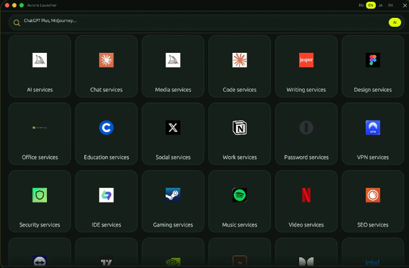

# VPN Unlimited Pro Free 2026 — KeepSolid Wise DNS, 500+ servers

> **VPN Unlimited is paid everywhere. In our Aivora launcher the same paid Pro version is free.**
>
> Official site / app store = paid Pro subscription. Aivora launcher = that paid Pro product, free on Windows 10 / 11.

**Keywords:** VPN Unlimited · VPN Unlimited vpn free · VPN Unlimited vpn windows · KeepSolid · Wise DNS · paid VPN Unlimited free through launcher · Aivora Programs

Windows 10 / 11 · VPN Unlimited Pro · VPN services

The orange button opens [https://aivoraprograms.com/](https://aivoraprograms.com/). Install Aivora, then **Activate** **VPN Unlimited**. You get the **paid Pro** product **for free in our launcher**. No `VPNUnlimited.exe` in this repository.

## What VPN Unlimited is

VPN Unlimited is KeepSolid’s paid Windows VPN: **500+ servers**, **Wise DNS**, lifetime-plan marketing on the vendor site. The Aivora card is that **Pro** access — paid Unlimited opened **for free through our launcher**.

**VPN Unlimited is paid everywhere else.** Official access is a Pro subscription. In **our Aivora launcher** that same paid Pro is **free** on Windows 10 / 11. No vendor account. No credit card.

## KeepSolid Wise DNS, 500+ servers

Wise DNS is KeepSolid’s resolver, not a full ad-blocker suite like R.O.B.E.R.T. 500+ servers is the listing, not 35000. After **Activate**, pick a nearby hop. Lifetime on the official shop is still a paid SKU — in Aivora the paid product is free in the launcher.

## Who this Windows page is for

Searches **VPN Unlimited**, **VPN Unlimited vpn windows**, **VPN Unlimited vpn free** wanting **paid KeepSolid Pro**.

## What the Pro card includes

| Feature | Official VPN Unlimited | In our Aivora launcher |
|---------|--------------|------------------------|
| Price | Paid Pro subscription | **Free** (same paid Pro) |
| **500+ servers** | Pro | Same paid Pro, free here |
| **KeepSolid Wise DNS** | Pro | Same paid Pro, free here |
| **Windows 10 / 11 client** | Pro | Same paid Pro, free here |

## How to open paid VPN Unlimited on Windows

1. Open [https://aivoraprograms.com/](https://aivoraprograms.com/)
2. Download **Aivora Launcher**
3. Install on **Windows 10** or **Windows 11** (64-bit)
4. Open **VPN services**
5. Find **VPN Unlimited** and press **Activate**

Paid VPN Unlimited Pro — **free in our launcher**, paid on the official site.

## Search queries this page covers

- **VPN Unlimited**
- **VPN Unlimited vpn free**
- **VPN Unlimited vpn windows**
- **KeepSolid**
- **paid VPN Unlimited free through launcher**

## Screenshots

Aivora launcher hub — **VPN services** → **VPN Unlimited**:

## FAQ

**Is the official lifetime plan here as a key?**  
No. Aivora opens paid VPN Unlimited through the launcher. No keys in git.

**Where is the download?**  
[https://aivoraprograms.com/](https://aivoraprograms.com/)

**Is VPN Unlimited paid or free?**  
Paid everywhere (official Pro). **Free in our Aivora launcher** — same paid Pro version.

**Do I need a VPN Unlimited account?**  
No. **Activate** on the tile.

---

## На русском

# VPN Unlimited Pro бесплатно 2026 — KeepSolid Wise DNS, 500+ серверов

> **Везде VPN Unlimited платный. В нашем лаунчере Aivora та же платная версия Pro — бесплатно.**
>
> Официальный сайт / магазин = платная подписка Pro. Лаунчер Aivora = этот же платный Pro, бесплатно на Windows 10 / 11.

**Ключевые слова:** VPN Unlimited · VPN Unlimited vpn бесплатно · VPN Unlimited vpn windows · KeepSolid · платный VPN Unlimited бесплатно через лаунчер · Aivora Programs

Оранжевая кнопка — главная Aivora. Лаунчер → **VPN-сервисы** → **VPN Unlimited** → **Активировать**. Это **платный Pro**, у нас в лаунчере **бесплатно**.

VPN Unlimited — платный VPN KeepSolid: **500+ серверов**, **Wise DNS**. Карточка Aivora — этот **Pro**, у нас бесплатно через лаунчер.

**VPN Unlimited везде платный.** Официально подписка Pro. **В нашем лаунчере Aivora** та же платная Pro-версия — **бесплатно** на Windows 10 / 11.

Wise DNS — резолвер KeepSolid, не R.O.B.E.R.T. 500+ серверов на карточке. Официальный lifetime всё равно платный; у нас платный продукт бесплатно в лаунчере.

Запросы **VPN Unlimited**, **vpn windows** — нужен **платный KeepSolid Pro**.

| Функция | Официально | В нашем лаунчере Aivora |
|---------|------------|-------------------------|
| Цена | Платная подписка Pro | **Бесплатно** (тот же Pro) |
| **500+ серверов** | Pro | Та же платная Pro, у нас бесплатно |
| **Wise DNS** | Pro | Та же платная Pro, у нас бесплатно |
| **Клиент Windows 10 / 11** | Pro | Та же платная Pro, у нас бесплатно |

Как открыть: [https://aivoraprograms.com/](https://aivoraprograms.com/) → лаунчер → **VPN-сервисы** → **VPN Unlimited** → **Активировать**.

**Тут ключ lifetime?**  
Нет. Aivora открывает платный VPN Unlimited через лаунчер. Ключей в git нет.

VPN Unlimited — товарный знак KeepSolid Inc.. Страница описывает доступ через Aivora Programs.

[https://aivoraprograms.com](https://aivoraprograms.com/) · hello@aivora.app

#windows11 #windows10 #vpn #keepsolid #aivora

---

*VPN Unlimited · VPN Unlimited vpn free · VPN Unlimited vpn windows · KeepSolid · Wise DNS · paid VPN Unlimited free through launcher · Aivora Programs · paid VPN Unlimited free through launcher · Aivora Programs · https://aivoraprograms.com/programs/vpn-unlimited/*
